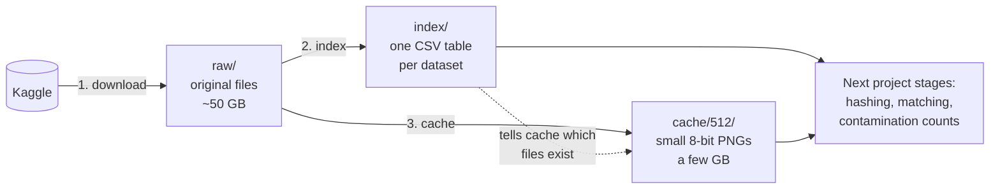

# Code Manual: the data pipeline, explained step by step

This manual is for reading the code together as a group, even if you have never programmed
before. It goes through every file in the order the data flows, says **what** each part does,
**why** the project needs it, and points to the exact lines (click the `Lxx` links on GitHub).

> **How to use it in a meeting:** open this file on GitHub (or in VS Code: right-click →
> *Open Preview*) on one screen and the linked code on another. Read one section, click the links, read the code, then try the "Try it" box.
> Sections 1–3 take about 20 minutes; each file after that takes 15–30 minutes.

---

## Contents

1. [The big picture](#1-the-big-picture)
2. [Python crash course: the 12 things you need to read this code](#2-python-crash-course)
3. [Map of the repository](#3-map-of-the-repository)
4. [`config.py` — the list of datasets and where data lives](#4-configpy--the-list-of-datasets-and-where-data-lives)
5. [`download.py` — getting the data from Kaggle](#5-downloadpy--getting-the-data-from-kaggle)
6. [`inventory.py` — one table per dataset](#6-inventorypy--one-table-per-dataset)
7. [`cache.py` — small working copies of every image](#7-cachepy--small-working-copies-of-every-image)
8. [`prepare_data.py` — the command you actually type](#8-prepare_datapy--the-command-you-actually-type)
9. [`viewer.py` and the notebooks — looking at the data](#9-viewerpy-and-the-notebooks--looking-at-the-data)
10. [The cluster scripts (`scripts/hpc/`)](#10-the-cluster-scripts-scriptshpc)
11. [Small support files](#11-small-support-files)
12. [What the output looks like](#12-what-the-output-looks-like)
13. [Glossary](#13-glossary)
14. [Questions to discuss as a group](#14-questions-to-discuss-as-a-group)

---

## 1. The big picture

Our project asks: *how many images (and patients) are shared between four public chest X-ray
collections, and does that sharing contaminate their official train/test splits?*

Before any image can be compared, we need the images **on disk, described, and in a uniform
format**. That is all this code does. It does **not** do any matching yet.



Three steps, three Python files:

| Step | File | Input | Output | Brief task |
|---|---|---|---|---|
| 1. Download | `download.py` | Kaggle | `raw/<dataset>/…` + provenance records + checksums | Task 02, bullet 1 |
| 2. Index | `inventory.py` | the raw files and their metadata | `index/<dataset>.csv` | Task 02, bullet 2 |
| 3. Cache | `cache.py` | the index + raw files | `cache/<size>/<dataset>/…png` | Task 02, bullet 3 |

The four datasets (we call each one a **collection** and give it a short **key**):

| Key | Collection | Format | Has patient IDs? | Has official split? |
|---|---|---|---|---|
| `nih` | NIH ChestX-ray14 | PNG | yes | yes: `train_val` / `test` |
| `rsna` | RSNA Pneumonia Challenge | DICOM (`.dcm`) | only one ID per image | yes: `train` / `test` |
| `covid` | COVID-19 Radiography Database | PNG | no | no |
| `kermany` | Pediatric X-rays (Kermany et al.) | JPEG | hidden in the file name | yes: `train` / `val` / `test` |

---

## 2. Python crash course

You only need these ideas to follow every file. Each has a tiny example you can type into
Python: in VS Code open a terminal (**Terminal → New Terminal**), type `python`, then the
lines after `>>>`. Or type them into a cell of a Jupyter notebook and press **Shift+Enter**.

**1. Variables** store a value under a name.
```python
>>> size = 512
>>> name = "nih"
```

**2. Types you will see:** `int` (whole number, `512`), `float` (`0.14`), `str` (text, `"nih"`),
`bool` (`True`/`False`), `None` (= "no value").

**3. Lists** `[...]` are ordered collections; **sets** `{...}` are unordered with no duplicates
(very fast for "is X in here?"); **dictionaries** `{key: value}` look things up by key.
```python
>>> splits = ["train", "test"]
>>> test_images = {"a.png", "b.png"};  "a.png" in test_images   # -> True
>>> ages = {"nih": 45, "covid": 1};    ages["nih"]              # -> 45
```

**4. Functions** are named, reusable blocks. `def` defines one, `return` gives back a result.
The bits after `:` and `->` are **type hints** — notes for humans, Python ignores them.
```python
def resize_long_side(img: np.ndarray, size: int) -> np.ndarray:
    ...
```
reads as: "takes an image array and a whole number, returns an image array".

**5. `if` / `for`** — decisions and loops. Indentation (4 spaces) shows what belongs inside.
```python
for split in ("train", "val", "test"):
    if split == "test":
        print("evaluation half")
```

**6. f-strings** put values inside text: `f"{n} images"` → `"5 images"`.

**7. `import`** loads code from elsewhere: Python's own (`json`, `hashlib`), installed packages
(`pandas`, `numpy`), or our own files (`from .config import COLLECTIONS` — the dot means
"from this same folder"). From a notebook you write `from chest_overlap import load_index`;
that works because our code is *installed* (see `pyproject.toml`, section 11).

**8. Classes / dataclasses** describe a "kind of thing" with named fields. A `@dataclass` is a
shortcut for a class that just holds data — like a form with fixed boxes.

**9. Exceptions** are errors. `raise` creates one; `try: … except: …` catches one so the
program can carry on or print a helpful message.

**10. `pathlib.Path`** represents a file path and works the same on Windows and Linux.
`root / "raw" / "nih"` glues parts together into `root/raw/nih`.

**11. pandas `DataFrame`** = a spreadsheet in Python (rows and named columns). Our "index"
tables are DataFrames saved as `.csv` files, which you can open in Excel.

**12. numpy array** = a grid of numbers. A greyscale image *is* a 2-D numpy array: each number
(0 = black … 255 = white) is one pixel.

**Underscore convention:** a name starting with `_` (like `_run_kaggle`) means "internal helper,
only used inside this file".

---

## 3. Map of the repository

```
Group-4/
├── README.md                ← short "how to run" instructions
├── docs/
│   ├── GETTING_STARTED.md   ← GitHub, VS Code, cluster and Jupyter setup
│   └── MANUAL.md            ← this file
├── pyproject.toml           ← makes our code installable + lists the packages it needs
├── requirements.txt         ← one line: "install this project with notebook extras"
├── .vscode/                 ← shared VS Code settings and recommended extensions
├── .gitignore               ← files git must never upload (data, passwords)
├── .gitattributes           ← keeps line endings Linux-friendly
├── notebooks/
│   └── 01_explore_data.ipynb ← first look at the data (start here)
├── src/chest_overlap/       ← the actual logic (a Python "package")
│   ├── __init__.py          ← lists what you can import from the package
│   ├── config.py            ← which datasets exist, where data is stored
│   ├── download.py          ← step 1
│   ├── inventory.py         ← step 2
│   ├── cache.py             ← step 3
│   └── viewer.py            ← show images in notebooks
└── scripts/
    ├── prepare_data.py      ← the command-line entry point you run
    └── hpc/                 ← helper scripts for the RWTH cluster
        ├── setup_env.sh
        ├── download.sbatch
        └── cache.sbatch
```

**Why split `src/`, `scripts/` and `notebooks/`?** `src/` holds reusable building blocks.
`scripts/` holds what you *run* as a command or cluster job. `notebooks/` is where you
*explore*: it imports from `src/`. The logic is written once and reused everywhere. If you
write a useful function in a notebook, move it into `src/` so others can use it too.

---

## 4. `config.py` — the list of datasets and where data lives

File: [`src/chest_overlap/config.py`](../src/chest_overlap/config.py)

This file contains **no processing**. It is the single place where facts about the datasets
are written down, so no other file has to hard-code them.

### 4.1 `REPO_ROOT` — [L14](../src/chest_overlap/config.py#L14)
```python
REPO_ROOT = Path(__file__).resolve().parents[2]
```
`__file__` is the path of `config.py` itself. `.parents[2]` walks two folders up
(`config.py` → `chest_overlap/` → `src/` → **repo**). So the code always knows where the
repository is, wherever it was cloned.

### 4.2 `data_root()` — where does the data go? [L17–L33](../src/chest_overlap/config.py#L17)
The datasets are ~50 GB, so *where* they are stored matters. The function checks, in order:

1. a folder passed explicitly (`--data-root` on the command line),
2. the environment variable `CHEST_OVERLAP_DATA` if someone set it,
3. **`$HPCWORK/chest_overlap`** — on the RWTH cluster `$HPCWORK` is your large storage area,
4. otherwise a `data/` folder inside the repo (useful on a laptop for small tests).

The first one that exists wins. On the cluster you normally do nothing and get option 3.

> **Why not `$HOME`?** The home folder on the cluster has a small quota. 50 GB would fill it.

### 4.3 `Collection` — a "form" describing one dataset [L36–L54](../src/chest_overlap/config.py#L36)
A dataclass with these boxes:

| Field | Meaning | Example (`nih`) |
|---|---|---|
| `key` | short name used everywhere | `"nih"` |
| `name` | human name | `"NIH ChestX-ray14"` |
| `kaggle_kind` | Kaggle *dataset* or *competition* (different download commands) | `"dataset"` |
| `kaggle_ref` | the `owner/name` part of the Kaggle URL | `"nih-chest-xrays/data"` |
| `reference` | the paper to cite | Wang et al. 2017 |
| `approx_size` | how big the download is | `~45 GB` |
| `metadata_files` | small files we can fetch *without* the images | `Data_Entry_2017.csv`, … |
| `extra_urls` | files that are not on Kaggle | (RSNA mapping file) |
| `notes` | warnings for humans | |

`frozen=True` means once created, the form cannot be changed by accident.
`kaggle_url` ([L50](../src/chest_overlap/config.py#L50)) builds the web address from
`kaggle_kind` and `kaggle_ref`. `@property` lets you write `col.kaggle_url` without brackets.

### 4.4 `COLLECTIONS` — the four filled-in forms [L57–L120](../src/chest_overlap/config.py#L57)
A dictionary from key → `Collection`. Read each entry; this is where you see the facts the
rest of the code relies on. Two things worth noticing:

* **RSNA `extra_urls`**: RSNA published a JSON file that says, for every RSNA image, which
  ChestX-ray14 image it was made from. That is our **positive control** for free — known
  true matches between two collections.
* **RSNA notes**: you must click "accept rules" on the Kaggle competition page once,
  otherwise the download is refused.

### 4.5 `get_collection()` [L123](../src/chest_overlap/config.py#L123)
Looks up a key; if you mistype (`"nhi"`), it stops with a clear message listing valid keys
instead of a confusing crash.

> **Try it:** in a terminal at the repo root:
> ```bash
> python scripts/prepare_data.py info
> ```
> It prints every collection and which data folder is in use — all of it comes from this file.

---

## 5. `download.py` — getting the data from Kaggle

File: [`src/chest_overlap/download.py`](../src/chest_overlap/download.py)

**Job:** put each dataset into `raw/<key>/`, and write down *exactly what we downloaded*
(the brief asks for version, download date, licence and a checksum per file).

### 5.1 How we talk to Kaggle [L33–L100](../src/chest_overlap/download.py#L33)
Kaggle ships a command-line tool called `kaggle`. Instead of using its Python library (which
changed a lot between versions), we **run the command** from Python with `subprocess.run`,
exactly as if you typed it in a terminal.

* `_kaggle_cmd()` ([L36](../src/chest_overlap/download.py#L36)) finds the `kaggle` program;
  if missing, tells you to `pip install -r requirements.txt`.
* `_run_kaggle(args)` ([L47](../src/chest_overlap/download.py#L47)) runs it and captures its
  output. **If it fails, it reads the error text and adds a hint**: "credentials missing" →
  how to get a token; "403/rules" → go accept the RSNA rules. This is there because those are
  the two mistakes everyone makes the first time.
* `_kaggle_download()` ([L78](../src/chest_overlap/download.py#L78)) builds the command:
  `kaggle datasets download nih-chest-xrays/data -p <folder> [-f <one file>]`.
  For RSNA it says `competitions` instead of `datasets`.
* `_kaggle_dataset_metadata()` ([L86](../src/chest_overlap/download.py#L86)) asks Kaggle for the
  dataset's description (title, licence…) to store in our provenance record. It is "best
  effort": if it fails, we record the error and carry on — the data itself is what matters.

### 5.2 Unzipping and other files [L105–L127](../src/chest_overlap/download.py#L105)
Kaggle delivers everything as `.zip`. `_extract_all_zips()` unpacks every zip in the folder
(with a progress bar from `tqdm`) and deletes the zip afterwards to save space, unless you
pass `--keep-zip`.

`_fetch_url()` downloads a plain web file (the RSNA mapping JSON). It first saves to
`name.part` and only renames it when complete — so a half-finished download never looks like
a finished one.

### 5.3 Checksums — fingerprints of every file [L132–L172](../src/chest_overlap/download.py#L132)
A **SHA-256 checksum** is a 64-character fingerprint computed from a file's bytes. Change one
byte and the fingerprint changes completely. We store one per file so that:

* anyone can later prove they have *exactly* the same data (reproducibility), and
* it already finds **exact** duplicate files (step one of the brief's baseline methods).

`_sha256()` reads the file in 1 MB chunks (`1 << 20` = 1,048,576 bytes) so that huge files
never need to fit in memory.

`write_file_manifest()` walks through every file under `raw/<key>/` and writes
`manifests/<key>_files.csv` with columns `rel_path, size_bytes, mtime, sha256`.
**Clever bit:** hashing 112,000 files takes a while, so if the manifest already exists and a
file's size and modification time (`mtime`) are unchanged, it reuses the old checksum.

### 5.4 `download_collection()` — the main function [L177–L235](../src/chest_overlap/download.py#L177)
This is what the command line calls. Read it top to bottom; it is the recipe:

1. Make the folders `raw/<key>/` and `manifests/`.
2. **Three cases:**
   * `metadata_only=True` → download only the small CSV/list files (minutes, not hours).
     Useful to look at patient IDs and splits before committing to 45 GB.
   * a file called `.download_complete` already exists → **skip** (so re-running the job
     after a crash doesn't download 45 GB again). `--force` overrides.
   * otherwise → full download, unzip, then write the `.download_complete` marker with the date.
3. Fetch any `extra_urls` (the RSNA mapping).
4. Write `manifests/<key>_download.json` — the **provenance record**: source URL, date/time
   (UTC), Kaggle tool version, Python version, Kaggle metadata, notes.
5. Write the checksum manifest (unless `--no-checksum`).

> **Discuss:** why is the marker file written *after* unzipping, not before?
> (Answer: if the job dies halfway, there is no marker, so the next run redoes it.)

---

## 6. `inventory.py` — one table per dataset

File: [`src/chest_overlap/inventory.py`](../src/chest_overlap/inventory.py)

**Job:** each dataset describes its images differently (a CSV, DICOM headers, Excel sheets,
file names…). This file turns all four into tables with **the same columns**, so later code
can treat them identically.

### 6.1 The shared columns [L1–L31](../src/chest_overlap/inventory.py#L1)
The text at the top of the file (a *docstring*) defines them. Memorise these seven:

| Column | Meaning | Example |
|---|---|---|
| `collection` | which dataset | `nih` |
| `image_id` | unique name **across all datasets** | `nih/00000001_000` |
| `rel_path` | where the file is inside `raw/<key>/` (empty = not downloaded) | `images_001/images/00000001_000.png` |
| `patient_id` | the release's own pseudonymous patient ID, prefixed with the dataset | `nih:00000001` |
| `split` | official split name | `train_val`, `test` |
| `is_eval` | `True` if the image is on the evaluation (test) side | `True` |
| `subset` | sub-folder the release groups it in | `COVID`, `NORMAL` |

**Why the prefixes (`nih/`, `nih:`)?** Different datasets could reuse the same file name or
number. Prefixing makes every ID unique, and makes it impossible to mix up "patient 1 in NIH"
with "patient 1 in Kermany".

**No disease labels** are copied into the tables — the brief says the project uses none.

### 6.2 Two small helpers [L34–L44](../src/chest_overlap/inventory.py#L34)
* `_files_by_name()` searches a folder (and all sub-folders, that's what `rglob("*")` does) and
  builds a dictionary *file name → full path*. That way we can look up where
  `00000001_000.png` actually lives, whatever sub-folder Kaggle put it in.
* `_rel()` turns a full path into a path relative to `raw/<key>/`, written with `/` so the
  tables are the same on Windows and Linux.

### 6.3 NIH ChestX-ray14 — `index_nih()` [L50–L86](../src/chest_overlap/inventory.py#L50)
The easiest one: NIH ships everything in text files.

* `Data_Entry_2017.csv` has one row per image with `Patient ID`, age, sex, view position, size.
* `train_val_list.txt` and `test_list.txt` list which images belong to which half of the
  official split.

The function reads the CSV with pandas, reads both lists into **sets** (fast lookups), and for
each image decides its split. It then builds a new table with our standard columns plus
NIH-only extras (`follow_up`, `view_position`, `sex`, `age`, original size, pixel spacing).
`"{:08d}".format(1)` turns patient number `1` into `00000001` (8 digits, padded with zeros) —
the same way NIH writes it in file names.

> Note the strange column names `"OriginalImage[Width"` and `"Height]"` — that really is how
> NIH named them in the CSV.

### 6.4 RSNA — `read_dicom_header()` and `index_rsna()` [L92–L172](../src/chest_overlap/inventory.py#L92)
**DICOM** is the hospital format: one file holds the image *plus* a header full of tagged
information. The brief asks us to record the header fields about intensity:

* `BitsStored` — how many bits per pixel (8 → values 0–255; 12 → 0–4095),
* `PhotometricInterpretation` — `MONOCHROME2` means bright = dense (bone white);
  `MONOCHROME1` means the opposite and must be inverted,
* `WindowCenter`/`WindowWidth`, `RescaleSlope`/`RescaleIntercept`, LUT sequences — instructions
  for how to display the values.

`read_dicom_header()` ([L100](../src/chest_overlap/inventory.py#L100)) reads only the header
(`stop_before_pixels=True`, so it is fast) and returns those fields as `dcm_…` columns.

`index_rsna()` ([L116](../src/chest_overlap/inventory.py#L116)):
1. finds all `.dcm` files; the folder name (`stage_2_train_images` / `stage_2_test_images`)
   gives the split;
2. adds images listed in `stage_2_train_labels.csv` that aren't downloaded yet (so the table is
   complete even after a metadata-only download);
3. **joins the RSNA→NIH mapping file**: for each RSNA image it fills `linked_nih_image_id` and
   `linked_nih_patient_id`. The NIH patient number is the first 8 characters of the NIH file
   name (`00012773_000.png` → `00012773`);
4. reads the DICOM headers.

> **Important quirk:** in RSNA, `patientId` is different for *every image* — it is really an
> image ID. So RSNA alone cannot tell us which images share a patient; the mapping to NIH can.

### 6.5 COVID-19 Radiography — `index_covid()` [L178–L212](../src/chest_overlap/inventory.py#L178)
Images live in folders like `COVID/images/COVID-1.png`; there are also `masks/` folders
(outlines of the lungs) which are **not** X-rays, so they are skipped.

Each class has an Excel sheet (`COVID.metadata.xlsx`, …) whose `URL` column says **which
upstream source** the image came from. That is valuable provenance for us: it hints where
overlaps with other collections might be. The function matches sheet rows to files by name,
ignoring upper/lower case and the file extension, because the sheet names and the file names are not always written the same way.

This dataset has no patient IDs and no official split, so those columns stay empty.

### 6.6 Kermany — `kermany_patient()` and `index_kermany()` [L218–L265](../src/chest_overlap/inventory.py#L218)
The patient ID is hidden in the file name. Three patterns, written as **regular expressions**
(a mini-language for text patterns):

| File name | Pattern | Patient ID |
|---|---|---|
| `person1_bacteria_1.jpeg` | `^(person\d+)_` | `person1` |
| `NORMAL2-IM-1427-0001.jpeg` | `^(NORMAL2-IM-\d+)-\d+` | `NORMAL2-IM-1427` |
| `IM-0115-0001.jpeg` | `^(IM-\d+)-\d+` | `IM-0115` |

(`^` = start of the name, `\d+` = one or more digits, `( … )` = the part we keep.)

**Kaggle quirk:** the Kermany zip contains the whole dataset **twice** (`chest_xray/` and
`chest_xray/chest_xray/`) plus junk `__MACOSX` folders from a Mac. The function picks the
shallowest copy and prints which duplicates it ignored. (A nice anecdote for our report: the
re-release itself contains a duplicate!)

### 6.7 Putting it together — `build_index()`, `summarize()`, `load_index()` [L271–L328](../src/chest_overlap/inventory.py#L271)
* `INDEXERS` maps each key to its function, so `build_index("nih", …)` knows to call `index_nih`.
* `build_index()` runs the right function, puts the seven shared columns first (`_order`),
  sorts, **checks that no `image_id` appears twice** (a safety net), saves
  `index/<key>.csv`, and prints a summary.
* `summarize()` prints images listed, files on disk, distinct patients, split counts, and for
  RSNA how many images are linked to NIH.
* `load_index()` is what **you will use in notebooks** later:
  ```python
  from chest_overlap import load_index
  df = load_index()          # all four tables stacked into one
  df[df.collection == "nih"].patient_id.nunique()   # number of NIH patients
  ```

> **Try it (after indexing):** open `index/nih.csv` in Excel. You should see 112,120 rows,
> 30,805 distinct patients, 86,524 `train_val` and 25,596 `test` rows — the numbers from the
> NIH paper.

---

## 7. `cache.py` — small working copies of every image

File: [`src/chest_overlap/cache.py`](../src/chest_overlap/cache.py)

**Job:** the brief says to work from "a cached copy of every image at reduced resolution". The
originals are 1024×1024 and in three formats; the cache is **one format, one bit depth, one
size rule** for all four datasets, so every later comparison is fair.

The docstring at the top ([L1–L20](../src/chest_overlap/cache.py#L1)) is written so you can
copy it into the methods section of the report.

### 7.1 `load_gray8()` — open any image as 0–255 grey [L34–L62](../src/chest_overlap/cache.py#L34)
* **DICOM:** read the pixels, apply the rescale slope/intercept (`apply_modality_lut`), invert if
  `MONOCHROME1`, then stretch the stored range (e.g. 0–4095 for 12 bits) linearly onto 0–255.
  No display window is applied, so no information is thrown away on purpose.
* **PNG/JPEG:** colour → grey with Pillow's `convert("L")`; 16-bit images keep their top 8 bits
  (`>> 8` = divide by 256).

It returns the image and a small dictionary recording the original mode, bit depth and size.

### 7.2 `resize_long_side()` [L65–L71](../src/chest_overlap/cache.py#L65)
Shrinks so the **longer side** equals `size` (default 512), keeping the shape (no stretching,
no cropping, no padding). Uses `cv2.INTER_AREA`, the interpolation that averages pixels when
shrinking and gives the cleanest result. Images already smaller are left alone.

> **Discuss:** why keep the aspect ratio instead of forcing 512×512? (Kermany images are not
> square; squashing them would change the image and could hide or create matches.)

### 7.3 `_work()` and parallelism [L74–L90](../src/chest_overlap/cache.py#L74)
`_work()` handles **one** image: load → resize → save as PNG. If anything goes wrong it records
the error and continues, so one broken file doesn't stop 100,000 others.

`default_workers()` asks Slurm how many CPU cores this job was given
(`SLURM_CPUS_PER_TASK`), or uses all cores on a laptop.

### 7.4 `build_cache()` [L93–L140](../src/chest_overlap/cache.py#L93)
1. Take every indexed image that exists on disk; with `--limit 100` take a random 100
   (`random_state=0` makes the "random" choice the same every time — reproducible).
2. Skip images already in the cache (so re-running continues where it stopped).
3. Run `_work` on many images at once with a `ProcessPoolExecutor` (one process per core).
4. Print **images per second** — the brief says to *measure the cost on 100 images before
   sizing the study*; this number is that measurement.
5. Save `cache/<size>/<key>_cache.csv` with original size, mode, bits, new size and any error.

PNG is **lossless**, so the cache adds no compression artefacts of its own.

---

## 8. `prepare_data.py` — the command you actually type

File: [`scripts/prepare_data.py`](../scripts/prepare_data.py)

This is a thin "front desk" that turns what you type into calls to the three files above. It
uses `argparse`, Python's standard tool for command-line options.

* [L21](../scripts/prepare_data.py#L21): `sys.path.insert(0, …/src)` tells Python where our
  package lives, so `from chest_overlap… import …` works without installing anything.
* `_keys()` ([L26](../scripts/prepare_data.py#L26)) turns `all` into the four keys and checks
  typos.
* `main()` ([L34](../scripts/prepare_data.py#L34)) defines four **sub-commands**:

| Command | Calls | Useful options |
|---|---|---|
| `info` | prints `COLLECTIONS` | |
| `download <keys>` | `download_collection()` | `--metadata-only`, `--force`, `--keep-zip`, `--no-checksum` |
| `index <keys>` | `build_index()` | `--no-dicom-headers` |
| `cache <keys>` | `load_index()` then `build_cache()` | `--size`, `--limit`, `--workers`, `--overwrite` |

and one global option, `--data-root`, to use another folder.

If one dataset fails (say RSNA rules not accepted), it prints the error, **continues with the
others**, and at the end lists what failed and exits with code 1 (so Slurm marks the job as
failed).

```bash
python scripts/prepare_data.py --help            # every option, explained
python scripts/prepare_data.py download nih --metadata-only
python scripts/prepare_data.py index nih
```

---

## 9. `viewer.py` and the notebooks — looking at the data

### 9.1 `viewer.py` — pictures in a notebook
File: [`src/chest_overlap/viewer.py`](../src/chest_overlap/viewer.py)

Four small functions, all taking **rows of an index table**:

| Function | What it does |
|---|---|
| `image_path(row)` | the cached PNG if it exists (fast), otherwise the original file |
| `load_image(row)` | opens that file as a 0–255 grey numpy array (reuses `load_gray8` from `cache.py`) |
| `show(images, titles)` | draws a list of arrays side by side with matplotlib |
| `show_rows(df)` | `load_image` + `show` for every row of a table; skips files not on disk |

```python
from chest_overlap import load_index, show_rows
df = load_index(["kermany"])
show_rows(df[df.patient_id == "kermany:person1"])   # all images of one patient
```

### 9.2 `__init__.py` — the "front door" of the package
It imports the most useful functions from all files, so a notebook can write
`from chest_overlap import load_index, show_rows, build_cache` without knowing which file each
one is in.

### 9.3 `notebooks/01_explore_data.ipynb`
The starting notebook. Run it cell by cell; each section answers one question:

1. which data folder is used,
2. which collections are indexed,
3. an overview table (images, files on disk, patients, split),
4. the extra columns of each table,
5. a few example images per collection,
6. **positive control:** RSNA images next to the NIH image they came from,
7. a first overlap question: **patients whose images sit on both sides of the official
   split**, counted from the IDs alone.

Sections whose data is missing print a note instead of crashing, so the notebook can be opened
on a laptop with no data at all.

### 9.4 Progress bars
`download.py`, `inventory.py` and `cache.py` use `tqdm.auto`, which draws a neat progress bar in
notebooks and a text one in terminals and job logs.

---

## 10. The cluster scripts (`scripts/hpc/`)

These are **shell** scripts (the Linux command language), not Python. `setup_env.sh` is run
with `bash`. The job scripts start with `#!/usr/bin/zsh`, because RWTH requires zsh for batch
jobs. On the RWTH cluster you don't run heavy work directly on the login node; you submit a
**job** to **Slurm**, the queue system, which runs it on a compute node when resources are free.
How to use the cluster in general is explained in
[Getting Started, section 4](GETTING_STARTED.md#4-using-the-rwth-cluster-hpc).

### `setup_env.sh` — run once
1. `module load Python` — the cluster provides software as "modules" you switch on.
2. Creates a **virtual environment** (`~/venvs/chest_overlap`): a private Python with our
   packages, so we don't clash with anyone else's.
3. Installs `requirements.txt` (our package + all packages + the Jupyter kernel).
4. **Registers the kernel `chest_overlap`**, so VS Code (connected through Remote-SSH) and
   notebooks on the cluster can use this environment: *Select Kernel → chest_overlap*.
5. Creates `$HPCWORK/chest_overlap` and the `logs/` folder.

### `download.sbatch` and `cache.sbatch` — submitted with `sbatch`
The `#SBATCH` lines at the top are **requests to Slurm**, not comments:

| Line | Meaning |
|---|---|
| `--job-name=cxr_download` | name shown in the queue (`squeue --me`) |
| `--output=logs/%x_%j.out` | where printed output goes (`%x` = job name, `%j` = job number) |
| `--partition=c23ms` | which kind of node: the normal CPU nodes of CLAIX-2023 |
| `--time=12:00:00` | maximum run time; Slurm kills the job after it |
| `--cpus-per-task=32` | number of cores (the cache uses them all in parallel) |
| `--mem-per-cpu=2G` | memory per core |
| `##SBATCH --account=…` | double `#` = disabled; fill in and remove one `#` only if you were given a project ID |

Then they load Python, activate the environment and call `prepare_data.py`. In
`download.sbatch`, the line `if [ $# -eq 0 ]; then set -- all; fi` means "if you gave
`sbatch` no dataset names, use `all`".

```bash
sbatch scripts/hpc/download.sbatch          # submit
squeue --me                                 # is it running?
tail -f logs/cxr_download_<jobnumber>.out   # watch its output live
```

---

## 11. Small support files

* **`pyproject.toml`** — describes our project so `pip` can install it. It lists the packages and
  minimum versions: `kaggle` (download), `numpy` (arrays), `pandas` (tables), `pillow` +
  `opencv-python-headless` (images), `pydicom` (DICOM), `openpyxl` (Excel sheets), `tqdm`
  (progress bars), `matplotlib` (plots), plus `ipykernel`/`ipywidgets` for notebooks.
* **`requirements.txt`** — a single line, `-e .[notebook]`: "install *this* project (`.`) in
  *editable* mode (`-e`), with the notebook extras". Editable means changes you make in `src/`
  take effect immediately (in a running notebook: restart the kernel).
* **`.vscode/settings.json`** and **`.vscode/extensions.json`** — shared VS Code settings
  (find code in `src/`, Linux line endings, notebooks start in the repo folder) and the
  extensions VS Code suggests when you open the folder.
* **`.gitignore`** — git never uploads `data/`, `logs/`, zips, DICOMs, or `kaggle.json`. The
  data is far too big for GitHub, may not be redistributed, and the token is a password.
  **Never commit your `kaggle.json`.**
* **`.gitattributes`** — Windows and Linux end lines differently; Linux bash refuses Windows
  line endings in scripts. This file forces Linux endings for `.sh`, `.sbatch` and `.py`.

---

## 12. What the output looks like

```
$HPCWORK/chest_overlap/
├── raw/
│   ├── nih/        Data_Entry_2017.csv, train_val_list.txt, images_001/images/*.png, …
│   ├── rsna/       stage_2_train_images/*.dcm, …, pneumonia-challenge-dataset-mappings_2018.json
│   ├── covid/      COVID-19_Radiography_Dataset/COVID/images/*.png, *.metadata.xlsx, …
│   └── kermany/    chest_xray/train|val|test/NORMAL|PNEUMONIA/*.jpeg
├── manifests/
│   ├── nih_download.json     ← where/when/how it was downloaded
│   └── nih_files.csv         ← every file + SHA-256
├── index/
│   └── nih.csv, rsna.csv, covid.csv, kermany.csv
└── cache/512/
    ├── nih/…png, rsna/…png, covid/…png, kermany/…png
    └── nih_cache.csv, …
```

A few rows of `index/kermany.csv`:

| collection | image_id | rel_path | patient_id | split | is_eval | subset |
|---|---|---|---|---|---|---|
| kermany | kermany/test/PNEUMONIA/person1_bacteria_2 | chest_xray/test/PNEUMONIA/person1_bacteria_2.jpeg | kermany:person1 | test | True | PNEUMONIA |
| kermany | kermany/train/PNEUMONIA/person1_bacteria_1 | chest_xray/train/PNEUMONIA/person1_bacteria_1.jpeg | kermany:person1 | train | False | PNEUMONIA |

Notice `kermany:person1` appears on **both** sides of the split — that is exactly the kind of
patient-level contamination the project will count.

---

## 13. Glossary

| Term | Meaning |
|---|---|
| **Collection / dataset** | one of the four public image sets |
| **Release / re-release** | a published copy of a dataset (e.g. on Kaggle) |
| **Provenance** | the record of where data came from and how it was obtained |
| **Checksum / SHA-256** | fingerprint of a file's bytes; identical files ⇔ identical checksum |
| **Metadata** | data *about* the images (patient, split, size), not the pixels |
| **DICOM** | medical image file format with a tagged header |
| **Bit depth** | how many bits per pixel; 8 bits = 256 grey levels |
| **MONOCHROME1/2** | whether high values mean white (2) or black (1) |
| **Official split** | the train/test division the release publishes |
| **Evaluation half** | the test side of a split, assumed unseen during training |
| **Positive control** | pairs known to match (e.g. RSNA→NIH mapping) |
| **Negative control** | pairs known *not* to match (different patients) |
| **Cache** | reduced-size working copies, faster to process |
| **Interpolation** | how new pixel values are computed when resizing |
| **CLI** | command-line interface: a program you run by typing in a terminal |
| **Slurm / sbatch / job** | the cluster's queue system; `sbatch` submits a job |
| **`$HPCWORK`** | your large storage folder on the RWTH cluster |
| **Virtual environment (venv)** | a private Python installation for one project |
| **DataFrame** | a table in pandas |
| **Regular expression** | a pattern for matching text, like `^(IM-\d+)` |
| **Jupyter notebook** | a `.ipynb` file of cells: code, its results and text, run one at a time |
| **Kernel** | the Python process that runs a notebook's cells; ours is called `chest_overlap` |
| **Editable install** | `pip install -e .`: our code is importable, and edits apply without reinstalling |
| **Remote-SSH** | VS Code extension that lets VS Code work directly on the cluster |

---

## 14. Questions to discuss as a group

1. Which collections let us measure **patient-level** overlap directly, and which only
   image-level? (Hint: look at which have `patient_id`.)
2. The RSNA mapping gives known NIH↔RSNA pairs. How would we use them to measure the
   **detection power** of a matching method?
3. The cache uses 512 px. What would we gain or lose with 256 px? How would the `--limit 100`
   timing help us decide?
4. COVID-19 Radiography has no official split. How should we treat it in the contamination
   analysis?
5. Checksums only find *byte-identical* files. Why will they miss most of the duplicates the
   brief is interested in? (Rescaling, 8-bit conversion, re-compression…)
6. The cache converts MONOCHROME1 images by inverting them. What could go wrong in matching if
   we forgot this?
